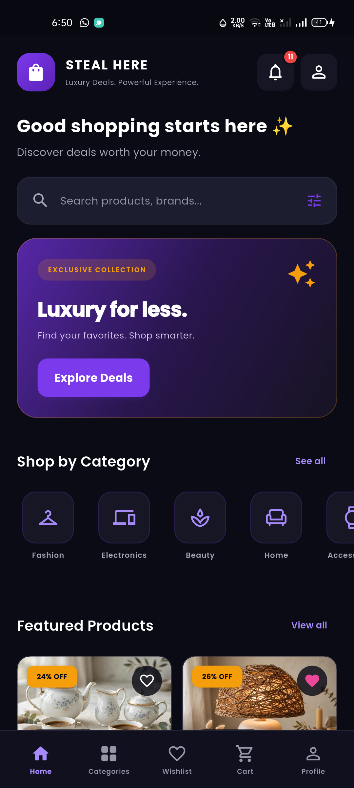
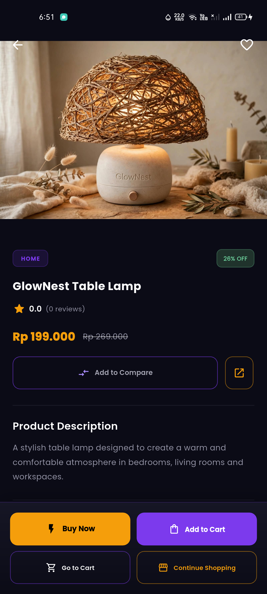
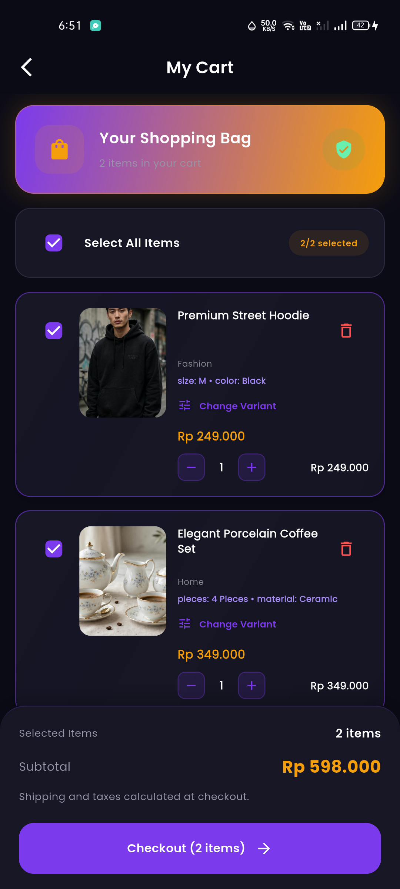
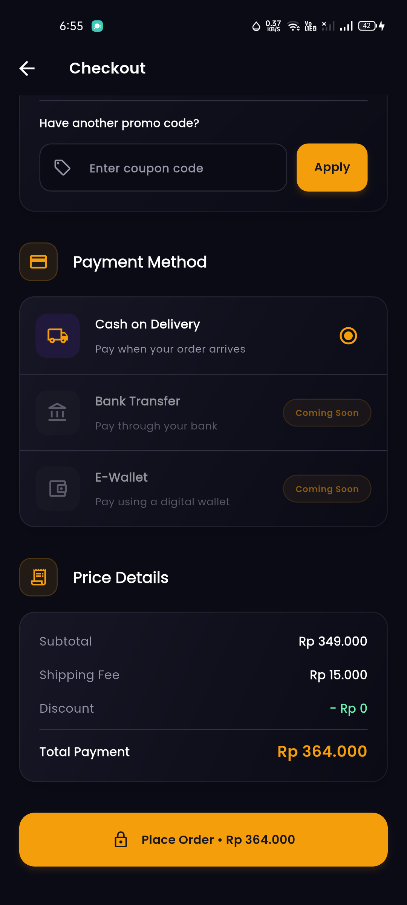
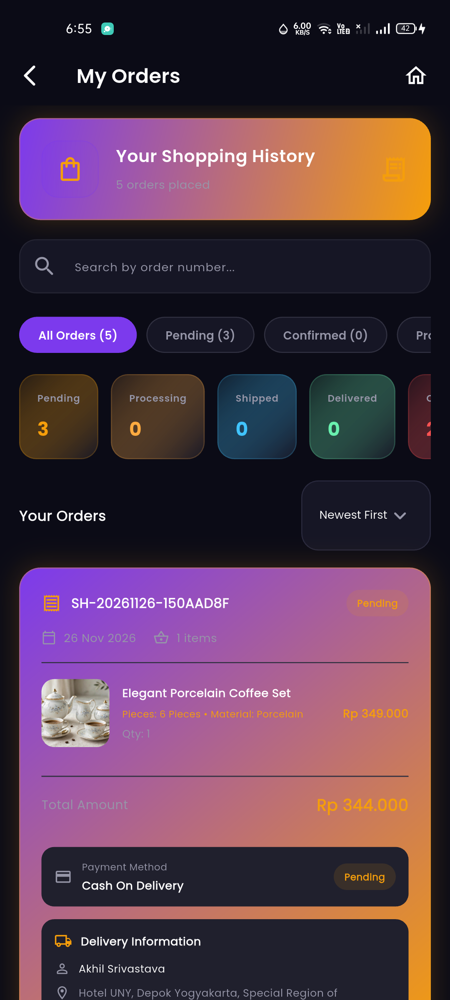
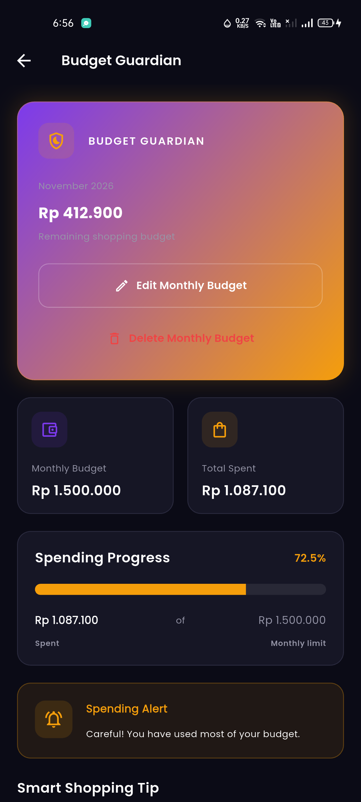
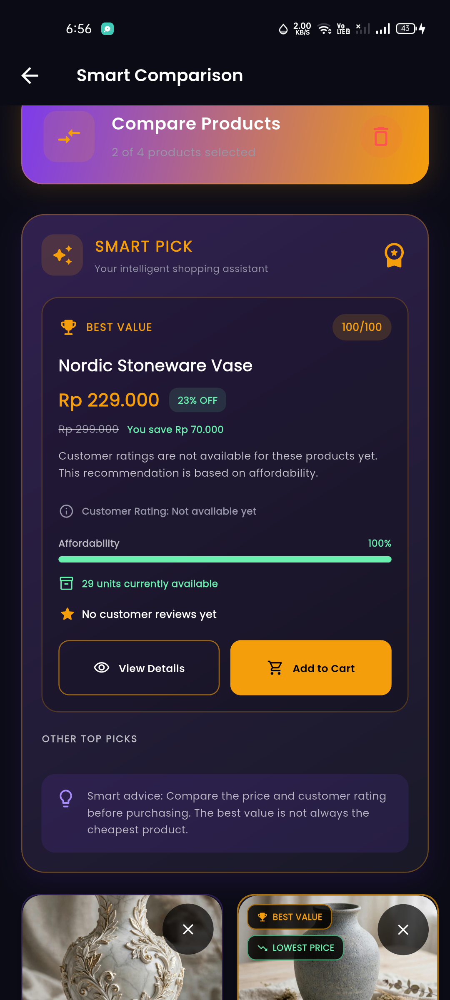
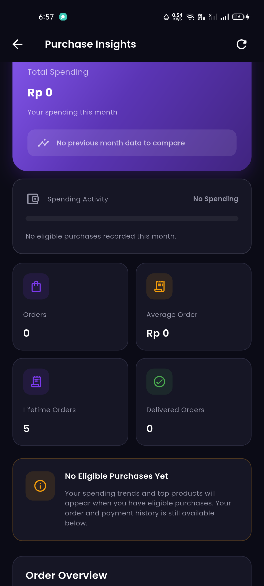

# 🛍️ Steal Here — Smart E-Commerce Application

**Luxury Deals. Powerful Experience.**

Steal Here is a smart e-commerce mobile application built with Flutter, Supabase, and PostgreSQL. It combines essential online shopping functionality with intelligent shopping assistance and spending-management features.

The platform aims to help users shop conveniently, compare products, manage their budgets, and make smarter purchasing decisions.

---

## 📱 Project Overview

Steal Here is designed as a next-generation shopping platform inspired by modern e-commerce applications.

Unlike traditional shopping applications, Steal Here focuses not only on purchasing products but also on helping customers make informed shopping decisions and manage their spending.

**Project Type:** Mobile Application<br>
**Platform:** Android<br>
**Version:** 1.0.0<br>
**Application ID:** `com.stealhere.app`<br>
**Development Status:** Version 1.0.0 — Release Build Completed

---

## ✨ Key Features

### 🛒 E-Commerce Features
- User registration and authentication.
- Email verification and password recovery.
- Product browsing and category navigation.
- Product details and image galleries.
- Shopping cart management.
- Wishlist management.
- Product search and discovery.
- Secure checkout workflow.
- Cash on Delivery (COD) payment.
- Order history and order details.

### 🧠 Smart Shopping Features
- **Budget Guardian:** Set monthly shopping budgets and monitor spending.
- **Purchase Insights:** View shopping and spending information.
- **Product Comparison:** Compare multiple products before purchasing.
- **Smart Coupon Centre:** Discover and apply available discounts.
- **Spending Awareness:** Track purchases to make more informed shopping decisions.

### 📦 Order Management
- Place and track orders.
- View order status and details.
- Request order cancellation.
- Submit return requests.
- Manage eligible return and refund scenarios.
- Automatic inventory restoration for eligible cancellations and returns.

### 👤 Account Management
- Customer profile management.
- Authentication and session persistence.
- Password reset functionality.
- Email verification through application deep links.

---

## 🛠️ Technology Stack

| Technology | Purpose |
|---|---|
| Flutter | Cross-platform mobile development |
| Dart | Application programming language |
| Supabase | Backend-as-a-Service |
| PostgreSQL | Relational database |
| Supabase Auth | User authentication |
| Supabase Storage | Product image storage |
| Provider | State management |
| GoRouter | Application navigation |
| Cached Network Image | Network image loading |
| Google Fonts | Typography |
| Shared Preferences | Local preferences |

---

## 🏗️ Application Architecture

The project follows a modular architecture to separate application logic, data access, and user interface components.


lib/
│
├── core/
│   ├── constants/
│   ├── themes/
│   ├── routes/
│   ├── utils/
│   └── services/
│
├── models/
│
├── providers/
│
├── repositories/
│
├── screens/
│   ├── splash/
│   ├── onboarding/
│   ├── auth/
│   ├── home/
│   ├── categories/
│   ├── product/
│   ├── wishlist/
│   ├── cart/
│   ├── checkout/
│   ├── orders/
│   ├── profile/
│   ├── analytics/
│   ├── budget/
│   └── compare/
│
├── widgets/
│
├── data/
│
└── main.dart


### Architecture Highlights

- **Models:** Represent application data.
- **Repositories:** Handle database operations and data access.
- **Providers:** Manage application state.
- **Screens:** Implement customer-facing interfaces.
- **Core:** Contains shared services, configuration, navigation, and utilities.
- **Widgets:** Provide reusable UI components.

---

## 🗄️ Backend and Database

Steal Here uses Supabase with PostgreSQL as its backend infrastructure.

Backend functionality includes:

- User authentication.
- Product management.
- Shopping cart management.
- Wishlist management.
- Order processing.
- Coupon management.
- Budget tracking.
- Return and cancellation workflows.
- Product image storage.

The application communicates with Supabase through its Flutter client.

**Note:** Backend credentials and private configuration must never be committed to a public repository.

---

## 📸 Application Screenshots

### Home Screen


### Product Details


### Shopping Cart


### Checkout


### Orders


### Budget Guardian


### Product Comparison


### Purchase Insights


## 🚀 Getting Started

### Prerequisites

Install the following development tools:

- Flutter SDK
- Dart SDK
- Android Studio
- Android SDK
- Visual Studio Code or Android Studio

### 1. Clone the Repository


```bash
git clone https://github.com/AkhilMonty/steal-here.git
```


### 2. Open the Project


```bash
cd steal-here
```


### 3. Install Dependencies


```bash
flutter pub get
```


### 4. Configure Supabase

Create a Supabase project and configure the required backend credentials in the application's Supabase configuration.

Ensure the required database tables, authentication settings, storage buckets, and database permissions are configured.

Never commit private keys, service-role credentials, or signing credentials.

### 5. Run the Application


```bash
flutter run
```


### 6. Build the Android Release APK

```bash
flutter build apk --release --target-platform android-arm64
```

The generated APK will be available at:

build/app/outputs/flutter-apk/app-release.apk

## 📦 Android Release

| Property | Value |
|---|---|
| Application Name | Steal Here |
| Package ID | `com.stealhere.app` |
| Version | 1.0.0 |
| Build Number | 1 |
| Platform | Android |
| Architecture | ARM64 |
| Payment Method | Cash on Delivery |

**Release APK:** `Steal_Here_v1.0.0_Android_Release.apk`

**Generated APK location:**

```text
build/app/outputs/flutter-apk/app-release.apk
```
## 🎯 Project Objectives

Steal Here was developed to explore how modern mobile technologies can improve the online shopping experience.

Its primary objectives are:

- Provide a convenient e-commerce shopping experience.
- Help customers make informed purchasing decisions.
- Encourage responsible spending through budget tracking.
- Reduce unnecessary purchases and impulse buying.
- Provide product comparison and shopping assistance.
- Implement a complete customer-facing order lifecycle.

## 🔮 Future Enhancements

Potential future improvements include:

- Dedicated administration application.
- Advanced recommendation algorithms.
- More detailed purchase analytics.
- Enhanced shopping personalization.
- Additional product discovery features.
- Further performance and security improvements.

## 👨‍💻 Developer

Developed as a Software Development Portfolio Project

Steal Here demonstrates practical experience with Flutter application development, Dart programming, Supabase integration, PostgreSQL database management, authentication, state management, and real-world e-commerce workflows.

## 📄 License

This project is currently developed as a personal portfolio project.

All rights reserved unless otherwise specified.